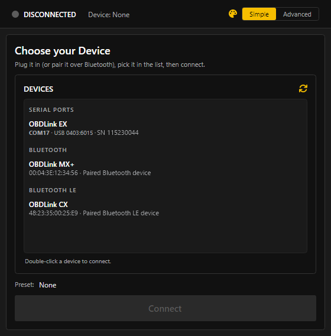

# STN Firmware Updater

A desktop app from OBD Solutions for updating the firmware on OBDLink scan tools, Carbyte and other STN-based devices. Plug the device in or pair it over Bluetooth, pick it from the list, and the app finds the newest firmware and installs it.

## Download

**[Download the installer for Windows](https://github.com/obdsol/StnFirmwareUpdater/releases/latest/download/ObdSolutions.StnFirmwareUpdater-win-Setup.exe)**

- Windows 10 or 11, 64-bit.
- The installer isn't code-signed yet, so Windows SmartScreen may warn about it. Choose **More info**, then **Run anyway**.
- It installs the .NET 10 Desktop Runtime if your PC doesn't have it.
- Every release, with a portable zip that needs no installation, is on the [Releases page](https://github.com/obdsol/StnFirmwareUpdater/releases).

Versions for macOS and Linux are in the works.

## Supported devices

| Device | Connection |
| --- | --- |
| OBDLink EX, OBDLink SX | USB |
| OBDLink MX+, OBDLink LX | Bluetooth |
| OBDLink CX, Carbyte | Bluetooth LE |

Other devices with an STN bootloader can be updated from the Advanced view, where every serial port is listed and every setting can be changed.

## Updating a device

1. **Power the device and connect it.** A scan tool is usually powered from the vehicle's OBD port. Plug a USB device into the PC. Pair a Bluetooth or Bluetooth LE device in Windows Settings > Bluetooth & devices first.
2. **Pick it in the DEVICES list and press Connect.** The app reads the device's model, serial number and current state. If the device isn't listed, press Refresh.
3. **Check the firmware to install.** The app looks up the firmware for your device and downloads it: usually the newest stable release for your model, or a release recommended for your particular device when there is one. To install something else, use **Choose another release…** or **Open a file…**.
4. **Press Update.** A progress bar shows how far along it is. Don't disconnect the device or close the app while it runs.
5. **Done.** The app says "Update succeeded", and the device restarts on the new firmware. A Bluetooth device restarts its Bluetooth as well, so give it a few seconds before you connect to it again.

## What the app does

### Simple and Advanced views

**Simple** is the view above: it lists only OBDLink and Carbyte devices and takes you through the update one step at a time.

**Advanced** shows everything on one screen:

- every serial port and paired Bluetooth device;
- the connection settings (baud rate, flow control, timings), which are filled in for a known device and stay editable;
- the firmware file's details: which devices it fits and what it contains;
- the device information: model, Device ID, hardware revision, serial number, bootloader version and whether valid firmware is loaded;
- a log of everything the app does.

You can switch between the two at any time, even during an update.

### Choosing firmware

- **Latest:** the stable releases for your device, each with its release date and changelog.
- **Beta:** pre-release firmware, when there is any for your device.
- **Private:** if OBD Solutions gave you a private code, enter it to see the releases it unlocks.
- **A file:** any STN firmware file (`.bin`) on your PC.

### Built-in safety

- **The firmware has to fit the device.** The app compares the device's Device ID with the ones the firmware file lists, and writes nothing if they don't match.
- **Every update is verified.** After the upload, the app asks the device whether the new firmware is valid.
- **An interrupted update isn't fatal.** If an update is aborted, or the device is unplugged or loses power partway, the device waits in its bootloader, even after it's unplugged. Connect to it again and run the update again to restore it.
- **You can abort.** Abort stops an update at once, and you can start it again straight away.

### Keeping the app up to date

The app checks for a new version of itself when it starts. When there is one, it asks before it installs it, and never while a device is connected or an update is running.

## For scripts and automation

The installer also puts a console program beside the app, at `%LocalAppData%\ObdSolutions.StnFirmwareUpdater\current\StnFirmwareUpdater.Cli.exe`. It never prompts, so it can run unattended.

| Command | What it does |
| --- | --- |
| `ports` | Lists the serial ports and Bluetooth devices the app can reach. |
| `info --port COM5` | Connects to a device and prints its information. |
| `inspect firmware.bin` | Prints a firmware file's details, without a device. |
| `update firmware.bin --port COM5` | Updates a device and reports one outcome. |

Use `--bluetooth <address>` or `--ble <address>` in place of `--port` for a Bluetooth or Bluetooth LE device, with the address `ports` shows. Add `--json` to `ports`, `info` and `inspect` for output a script can read. Each outcome has its own exit code (0 is success), and `--help` lists every option.

## If something goes wrong

- **The device isn't in the list.** Check that it's powered, and that a Bluetooth device is paired in Windows Settings, then press Refresh. In the Advanced view every port is listed, whether the app recognises it or not.
- **Connect fails.** Check that no other app is using the device, such as an OBD app or a serial terminal, and try again. A Bluetooth device has to be on and in range.
- **An update failed or was interrupted.** Connect again and run the update again. The device stays in its bootloader until an update completes.
- **Seeing what happened.** The Advanced view has a log of every step. Right-click it to copy it.
